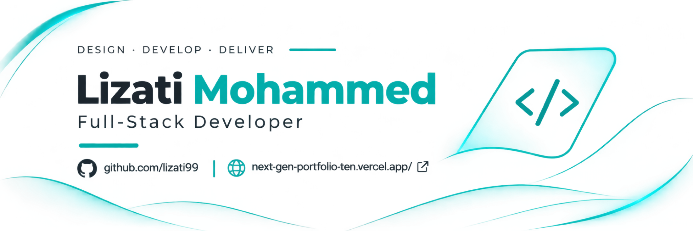
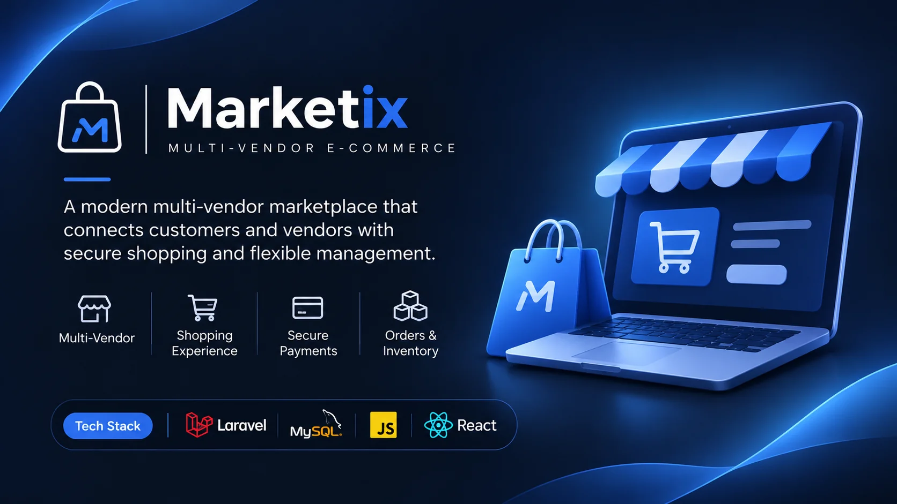
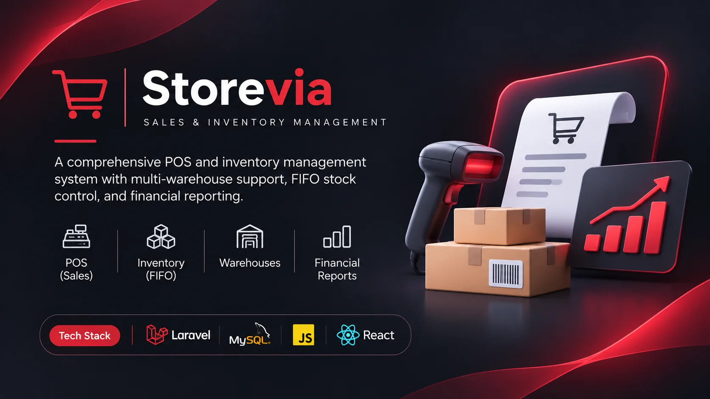
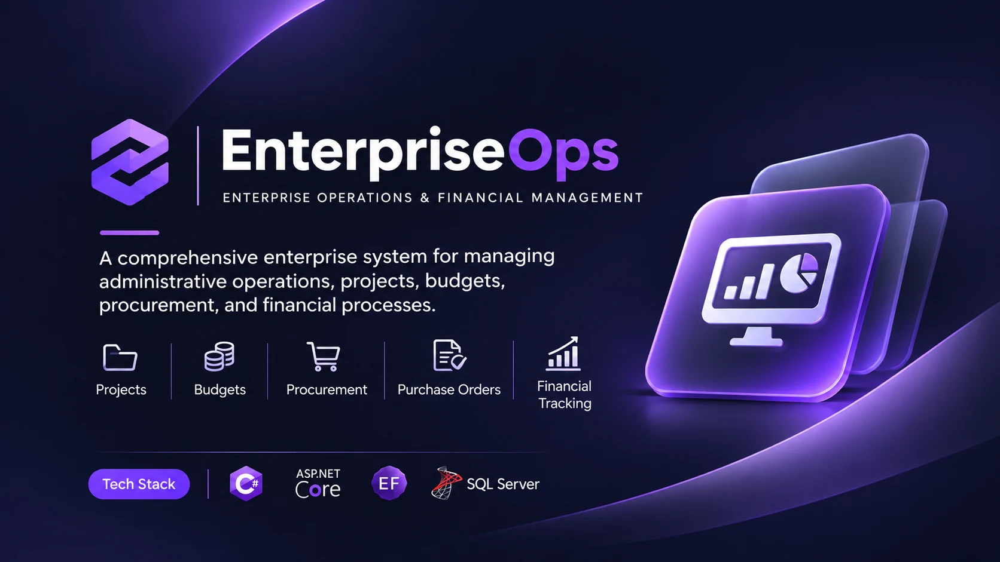
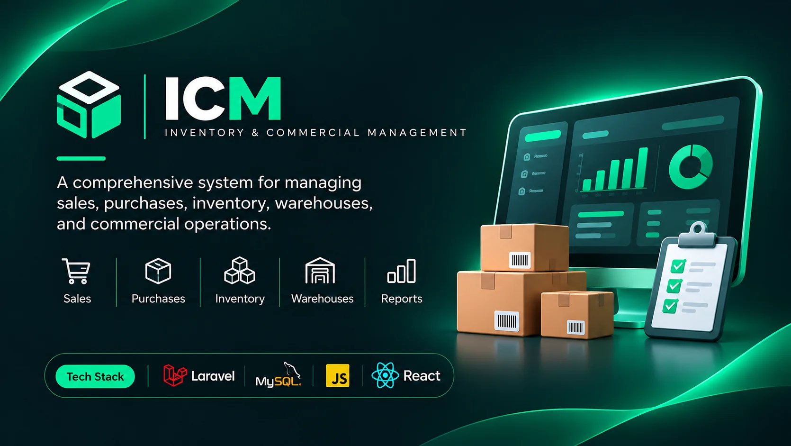
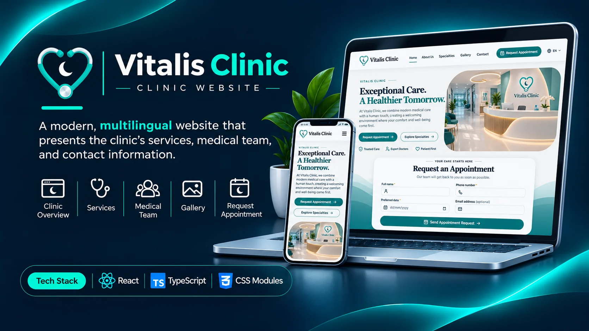

<picture>
  <source media="(prefers-color-scheme: dark)" srcset="./assets/banner-dark.webp">
  <source media="(prefers-color-scheme: light)" srcset="./assets/banner-light.webp">
  
</picture>

<h2>Hi, I'm Lizati Mohammed 👋</h2>

<strong>React · TypeScript · Laravel · C# · ASP.NET Core</strong>

Building modern, scalable, and user-focused web applications.

---

## 👨‍💻 About Me

I'm a **Full-Stack Developer** passionate about building reliable applications, intuitive interfaces, and maintainable software.

I work with modern frontend and backend technologies, combining thoughtful UI/UX with clean architecture and practical problem-solving.

---

## 🛠️ Tech Stack

<strong>Frontend</strong>

  

  

<strong>Backend</strong>

  

  

<strong>Databases & Tools</strong>

  

---

## 🚀 Featured Projects

A selection of my work across multi-vendor marketplace, enterprise operations, business management systems, and healthcare.

### 🛒 Marketix

**Multi-Vendor Marketplace Platform**

A full-stack marketplace combining product discovery, shopping cart management, vendor dashboards, and administrative tools.

**Tech:** `React` `Laravel` `MySQL` `Sanctum`

[📖 View Documentation](https://next-gen-portfolio-ten.vercel.app/#/projects/marketix/documentation)

---

### 🛍️ Storevia

**Point of Sale & Inventory Management**

A business management platform integrating point-of-sale operations, FIFO inventory tracking, warehouse management, and financial reporting.

[📖 View Documentation](https://next-gen-portfolio-ten.vercel.app/#/projects/storevia/documentation)

---

### 🏛️ EnterpriseOps

**Enterprise Operations & Financial Management**

Contributed to the backend and relational database of a large-scale enterprise information system supporting project approvals, budget management, purchase orders, procurement workflows, and financial tracking.

**My Contribution:** `Backend Development` · `Database Design`

**Tech:** `C#` `ASP.NET Core` `Entity Framework Core` `SQL Server`

[📖 View Documentation](https://next-gen-portfolio-ten.vercel.app/#/projects/enterpriseops/documentation)

---

### 📦 Inventory & Commercial Management

**Business Operations Management System**

A full-stack inventory and commercial management application powered by a Laravel REST API, supporting inventory tracking, commercial operations, and structured business workflows.

[📖 View Documentation](https://next-gen-portfolio-ten.vercel.app/#/projects/inventory-commercial-management/documentation)

---

### 🏥 Vitalis Clinic

**Multilingual Healthcare Website**

A modern healthcare website featuring responsive design, four-language support, Arabic RTL layouts, and interactive medical content.

**Tech:** `React` `TypeScript` `Vite` `i18next`

[🌐 Live Demo](https://vitalis-clinic-fawn.vercel.app/) · [💻 Source Code](https://github.com/lizati99/vitalis-clinic)

---

## 🌐 Let's Connect

Interested in my work or exploring a potential collaboration?

  

  

Clean Code · Thoughtful Design · Continuous Learning

